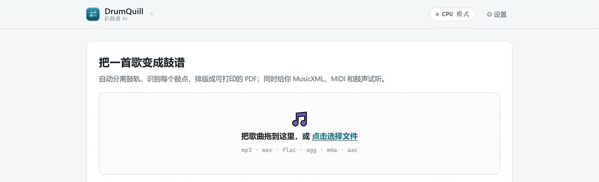
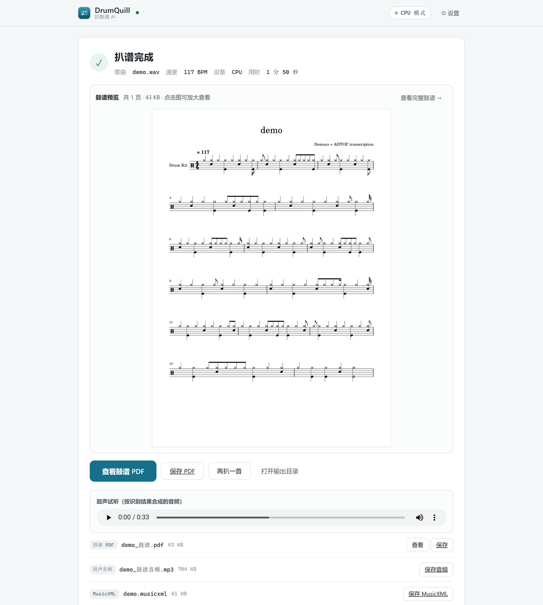
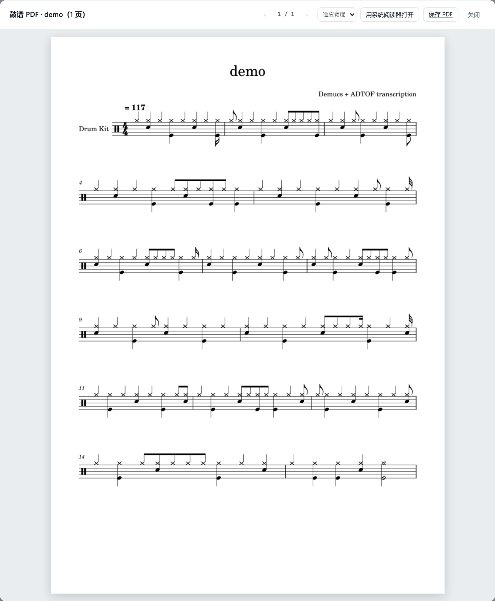
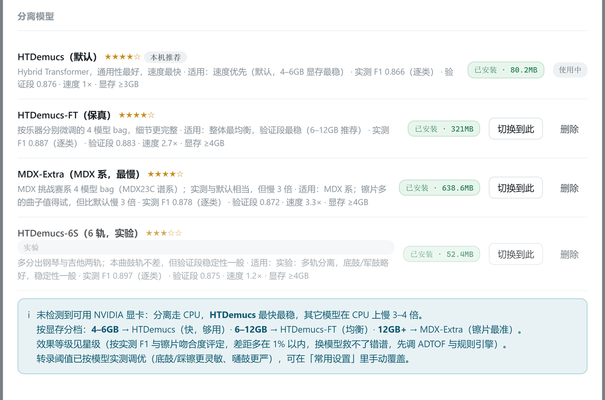

<div align="center">


# DrumQuill

把一首歌变成可以打印的鼓谱。

<sub>鼓轨分离 · 鼓点转录 · 排版导出 PDF —— 全部在本机完成</sub>

<br />


<br />



</div>

[特色](#特色) · [截图](#截图) · [安装](#安装) · [怎么用](#怎么用) · [产物](#产物) · [效果](#效果) · [设置](#设置里值得知道的几项) · [进阶](#进阶) · [常见问题](#常见问题) · [已知限制](#已知限制) · [致谢](#致谢) · [依赖与许可](#依赖与许可)

## 特色

**鼓谱是主角。** 跑完之后第一屏就是乐谱预览：翻页、缩放、用系统阅读器打开、另存 PDF，
不用先去文件夹里找文件。音频和 MusicXML 排在后面。

**产物可以接着改。** 除了 PDF，还给出 MusicXML 和 MIDI。谱面哪里不对，
用 MuseScore 打开 MusicXML 改那几个音符，再导出一次就行，不必从零重扒。

**按机器给建议。** 内置四个 Demucs 分离模型，界面按显存推荐并标注实测效果，
可下载、切换、删除。没有 NVIDIA 显卡就不建议装 GPU 组件，省下两个多 G 的下载。

**缺什么补什么。** 首次启动的向导按能力划分组件（转录引擎、分离模型、排版、音频），
可以只装要用的；之后在设置里单独补装、重装某一个组件，不用整套重来。

**产物管得住。** 历史记录里每首歌的成品与中间产物都能试听、查看、下载、
在文件夹中定位、单个删除或整首清空。更换分离模型后重新转录，也不会串用旧产物。

**出错有退路。** GPU 不可用回落 CPU；MuseScore 缺失时用内置渲染兜底；
转录器异常回退官方 CLI；显存不足按段长 7→5→3 递减重试。每一级降级都写进运行日志。

## 截图

**扒谱完成页** —— 左上是鼓谱预览，下面是按谱合成的鼓声与全部产物。



**鼓谱阅读器** —— 页面内翻页与缩放，也可以一键交给系统 PDF 阅读器。



<div align="center">

| 能力与组件 | 分离模型 |
| :---: | :---: |
|  |  |

</div>

## 安装

**方式一：绿色版（推荐）**

下载 [Release](https://github.com/PRTS168/DrumQuill/releases) 里的压缩包，解压到任意目录。

第一次运行请双击 `start.bat`：它会把依赖装进包内的 `.venv`（约 10 分钟，走镜像、可断点续传），
装完自动打开界面。之后直接双击 `dist\DrumQuill\DrumQuill.exe` 就能进界面。

> EXE 只负责开窗口，管线和依赖都在同一目录里，解压后请保持目录完整，别单独拷走 exe。

**方式二：源码运行**

需要 Windows 与 Python 3.9+。

```powershell
powershell -NoProfile -ExecutionPolicy Bypass -File bootstrap\ensure.ps1   # 检查并安装依赖
powershell -NoProfile -ExecutionPolicy Bypass -File app\start_server.ps1    # 启动界面
```

依赖装在仓库内的 `.venv`，不动系统 Python。

**方式三：拖拽**

把音频文件拖到 `一键扒谱.bat` 图标上，环境就绪后会直接开始处理，成品落在 `output\`。

## 怎么用

1. 拖入音频（MP3 / WAV / FLAC / OGG / M4A / AAC），或点「选择文件」。
2. 选择产物与设备：完整扒谱 / 只要谱子 / 只要音频 / 只要鼓声；分离设备可选自动、CPU、GPU。
3. 等进度走完。有 GPU 通常几分钟，纯 CPU 会慢一些。
4. 看鼓谱预览，试听鼓声，按需保存 PDF、MusicXML、MIDI 或音频。

不进界面也可以直接跑命令行：

```powershell
powershell -File run_pipeline.ps1 -SongPath "歌曲.mp3"
```

## 产物

| 文件 | 内容 |
| --- | --- |
| `output\<歌名>_鼓谱.pdf` | 鼓谱，任意 PDF 阅读器可打印 |
| `output\<歌名>.musicxml` | 乐谱交换格式，可在 MuseScore 里继续编辑 |
| `output\<歌名>_鼓谱音频.mp3` | 按谱合成的鼓声，用来对照转录准不准 |
| `output\<歌名>_鼓声.mp3` | 从原曲分离出的纯鼓轨（只要鼓声模式） |
| `midis\<歌名>_<BPM>.mid` | 校正后的 MIDI |
| `stems\<模型>\<歌名>\drums.wav` | 分离出的鼓轨（中间产物） |

中间产物默认保留，方便只重跑某一步 —— 比如换个分离模型再转录，不必重新分离整首歌。

## 效果

用人工扒的鼓谱当参考，在 150 秒素材上按**逐类起音微平均 F1**（每个鼓类单独比较，±50ms 容差，
先做全局相位对齐）衡量：

| 环节 | 参考段（前 60 秒） | 验证段（90–150 秒） |
| :--- | :---: | :---: |
| 分离 + 转录 | **0.894** | **0.921** |

分鼓类：军鼓 0.96 · 底鼓 0.91 · 踩镲 0.88 · 吊镲 0.80 · 嗵鼓 0.74。

耗时参考（一首 4 分钟的歌，4 线程 CPU、4GB 显存显卡）：

| 设备 | 分离 | 转录 | 合计 |
| :--- | :--- | :--- | :--- |
| GPU | 约 1 分钟 | 约 30 秒 | 2–3 分钟 |
| CPU | 3–5 分钟 | 约 30 秒 | 5–8 分钟 |

## 设置里值得知道的几项

| 项 | 作用 |
| --- | --- |
| 作业模式 | 完整 / 只要谱子 / 只要音频 / 只要鼓声 |
| 分离设备 | 自动（有 CUDA 用 GPU） / CPU / GPU |
| 分离模型 | 按显存推荐；镲片多的曲子可以试 MDX-Extra，代价是慢约 3 倍 |
| 转录阈值 | 五类鼓各自的灵敏度，留空即按当前分离模型取实测最优值 |
| 量化吸附容差 | 音符对齐十六分音符的容差，0 表示不量化 |
| 后处理 | 去抖去重、最短时值、摇摆量化（0–0.6） |
| 数据目录 | 成品与中间产物的根目录，可以换盘 |

设置都存在 `config.json` 里，字段说明见 [config.json.example](config.json.example)。

## 进阶

<details>
<summary><b>只重跑其中一步（省时间）</b></summary>

```powershell
# 已经有 drums.wav，直接转录 + 排版
powershell -File run_pipeline.ps1 -SongPath "歌曲.mp3" -SkipSeparation

# 手动指定速度（自动测速不准时）
powershell -File run_pipeline.ps1 -SongPath "歌曲.mp3" -BPM 156

# 只出音频 / 只出鼓声
powershell -File run_pipeline.ps1 -SongPath "歌曲.mp3" -SkipScore
powershell -File run_pipeline.ps1 -SongPath "歌曲.mp3" -OnlyStems
```

单独的步骤也可以直接调用：`scripts\detect_bpm.py`、`scripts\transcribe.py`、
`scripts\fix_align.py`、`scripts\gen_musicxml.py`、`scripts\postprocess.py`。

</details>

<details>
<summary><b>GPU 加速是怎么装的</b></summary>

设置 →「GPU 加速环境」→ 安装，会自动完成：

1. 读显卡型号与驱动版本（`nvidia-smi`；拿不到就按型号推断，AMD/Intel 直接说明不支持）
2. 按算力与驱动上限选 PyTorch 的 CUDA 轮子（Maxwell/Pascal → cu121，Turing → cu126，Ampere/Ada → cu128）
3. 建独立 `.venv-gpu` 装 `torch` + `torchaudio` + `demucs`（`--no-deps`，避免 torch 被换回 CPU 版）
4. 校验 `cuda.is_available()`、算力是否在 `arch_list` 里、能否真正加载模型，全过才算成功，
   失败会清掉半成品并保持 CPU 可用

已经有 CUDA 环境的，可以在设置里把 `gpuPython` 指过去，省下约 2.4GB 下载。

</details>

<details>
<summary><b>自己构建 EXE</b></summary>

```powershell
# 仓库根的 venv 里
pyinstaller --noconfirm --clean build_spec\DrumQuill.spec
# 产物：dist\DrumQuill\DrumQuill.exe（onedir，约 22MB）
```

spec 里的路径相对文件本身推导，clone 到任意目录都能构建。

</details>

<details>
<summary><b>目录结构</b></summary>

```
app/           Flask 服务、前端页面、启动器、安装器、模型与显卡探测
bootstrap/     环境检查与安装脚本
scripts/       管线各步骤：测速、转录、对齐、MusicXML、渲染兜底、GPU 探针
docs/          结构说明、回退矩阵、第三方许可
build_spec/    PyInstaller 打包配置
run_pipeline.ps1   六步管线主脚本
```

细节见 [docs/structure.md](docs/structure.md) 与 [docs/fallback_matrix.md](docs/fallback_matrix.md)。

</details>

## 常见问题

**端口被占。** 默认 8756，占用时自动改用 8757；想固定就改 `config.json` 的 `port`。

**下载慢或中断。** 默认走国内镜像，支持断点续传，重开会接着下。

**转出来的谱子不准。** 先确认用的是 GPU 与推荐分离模型；
再用 MuseScore 打开 MusicXML，对照原曲改掉错音后重新导出 PDF。这条路径目前最快见效。

**提示「已有任务在运行」但其实没有。** 看 `app\job.log` 与 `app\service.log`；
需要重置时删掉 `app\task_state.json` 再启动。

**换了新版本，打开却像没更新。** 启动器会比对程序文件指纹，发现更新会自动重启后台服务；
必要时在任务管理器结束 `pythonw.exe`（命令行含 `app.py`）后重新打开。

## 已知限制

- **只有五类鼓。** 转录引擎只输出底鼓、军鼓、嗵鼓、踩镲、吊镲；不区分开/闭踩镲，
  也没有叮叮镲（ride）。ride 段落会被记成吊镲或踩镲，这是模型能力限制，调参解决不了。
- **节拍来自 BPM 估计。** 没有做拍点跟踪，速度漂移明显的曲子，后半段可能出现小节错位。
- **平台。** 目前只支持 Windows；GPU 加速需要 NVIDIA 显卡。
- **商用限制。** ADTOF 权重为 CC BY-NC-SA 4.0，禁止商业使用，详见下面的许可一节。

## 致谢

- [Demucs](https://github.com/facebookresearch/demucs)（Meta AI Research / adefossez）—— 鼓轨分离模型
- [ADTOF-pytorch](https://github.com/xavriley/ADTOF-pytorch) 及 ADTOF 论文作者 —— 鼓点转录
- [MuseScore](https://musescore.org/) —— MusicXML 排版与 PDF 渲染
- [FFmpeg](https://ffmpeg.org/) —— 音频转码
- [PyMuPDF](https://github.com/pymupdf/PyMuPDF)、[Flask](https://flask.palletsprojects.com/)、
  [pywebview](https://pywebview.flowrl.com/)、[pretty_midi](https://github.com/craffel/pretty-midi)、
  [librosa](https://librosa.org/)、[PyTorch](https://pytorch.org/)、[NumPy](https://numpy.org/) —— 基础设施
- [MS Basic 音色库](https://musescore.org/) —— 鼓声合成音色

## 依赖与许可

本项目代码以 **MIT** 发布，见 [LICENSE](LICENSE)。运行时依赖见 [requirements.txt](requirements.txt)，
第三方组件的版本、许可证与注意事项见 [docs/third_party_licenses.md](docs/third_party_licenses.md)。

需要注意：**ADTOF 的模型权重是 CC BY-NC-SA 4.0，禁止商业使用**；
Demucs 权重为 MIT；MuseScore 与 MS Basic 音色库遵循各自许可。
打算商用的话，先把转录权重换掉，或取得授权。
