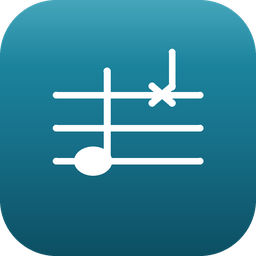
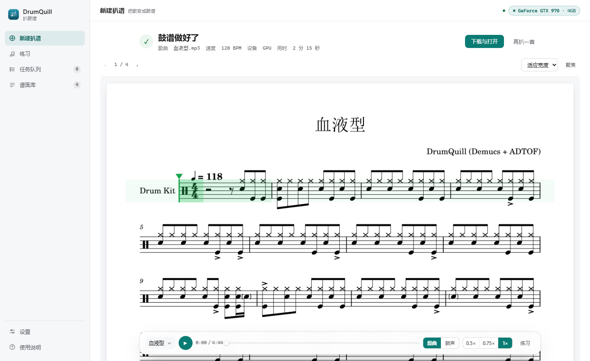
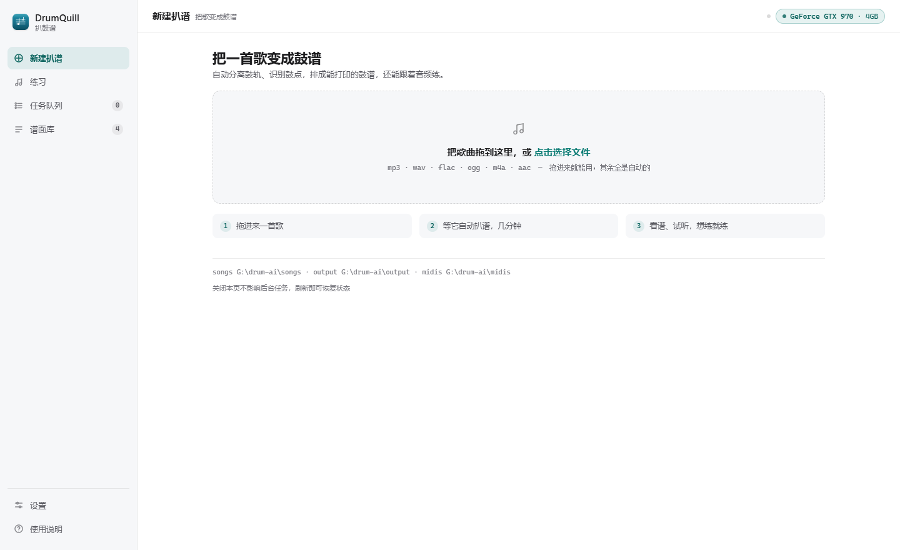
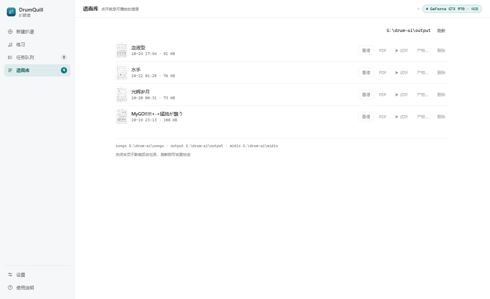
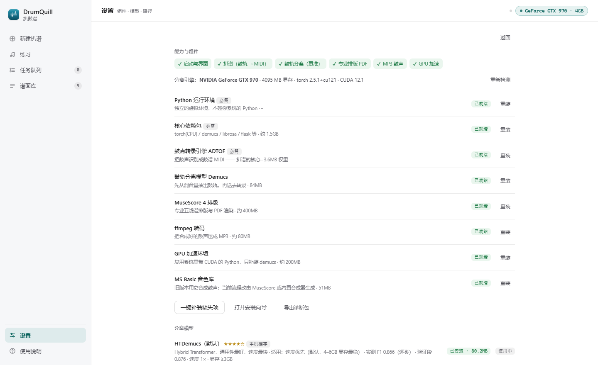
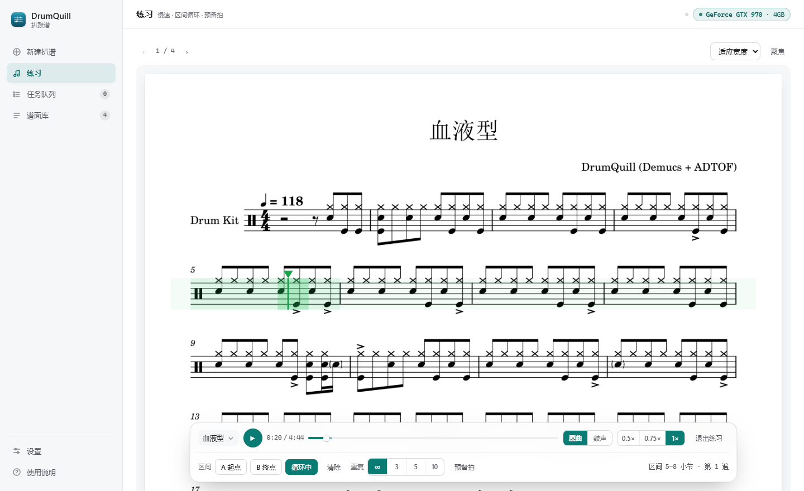
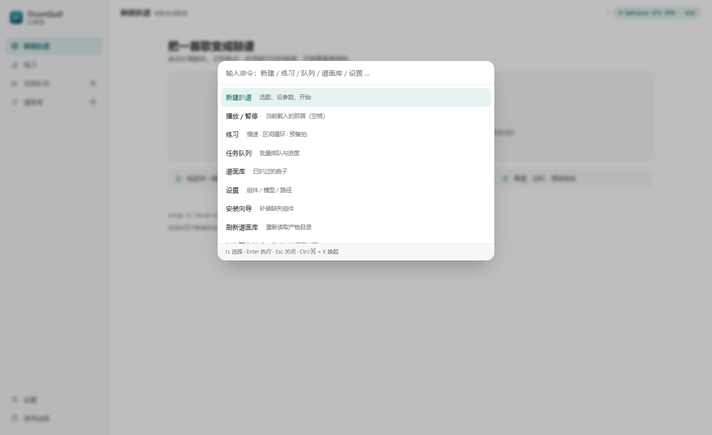

<div align="center">



# DrumQuill

把一首歌变成可以打印的鼓谱。

<sub>在本地完成鼓轨分离、鼓点转录与排版，产出 PDF 鼓谱；音频不出本机</sub>

<br />


<br />



</div>

[简介](#简介) · [特色](#特色) · [实测数据](#实测数据) · [截图](#截图) · [安装](#安装) · [怎么用](#怎么用) · [产物](#产物) · [设置](#设置里值得知道的几项) · [进阶](#进阶) · [常见问题](#常见问题) · [已知限制](#已知限制) · [致谢](#致谢) · [依赖与许可](#依赖与许可)

## 简介

给你一首歌，还你一份能打印、能编辑、还能跟着练的鼓谱。

整套流程都在本机跑：从混音里分出鼓轨，把每一次敲击识别成音符，按歌曲真实的拍点量化，
排成五线鼓谱导出 PDF；同一份结果还能导出 MusicXML 与 MIDI，并合成一段只有鼓的音频用来对照。
音频不会上传，也不需要联网账号。

做出来之后有三种用法：

- **打印**：PDF 直接进排练室，或者拿去当抄谱的底稿
- **继续改**：MusicXML 在 MuseScore 里打开，改掉那几个不准的音符再导出，不必从零重扒
- **跟着练**：谱面自己会走，可以放慢到半速、圈出几小节反复练

适合：想给一首歌记谱但不想从零手打；扒带时先要个底稿再精修；练鼓时对着谱面跟弹。
不适合：要求出版级排版、需要叮叮镲或闷音等细节记号的谱，以及商业用途
（转录权重为非商用许可，见文末）。

## 特色

**鼓谱是主角。** 跑完之后第一屏就是乐谱预览：翻页、缩放、交给系统 PDF 阅读器、另存，
不用先去文件夹里找文件。音频与 MusicXML 排在后面。

**谱面自己会走。** 谱面区展示的就是那张打印用的 PDF 页面：播放时绿色光标按谱面真实音符列
前进、当前行始终停在屏幕中部，翻页、换曲都由播放自己带过去；点谱面上任意位置即可从那里开始。
打印仍用同一份 PDF，动态与打印不会再是两套东西。

**能直接拿来练。** 侧栏「练习」把谱面单独铺满一屏；底下还是同一条播放器，只是多展开一行练习工具：
0.5×～0.75× 变速不变调；圈出某几小节反复练（区间直接高亮在进度条上）；重复 ∞ / 3 / 5 / 10 遍，
练够了自己停；要进拍子就点一次「预备拍」，先听一小节倒数的咔哒声。

**一条播放器，两页共用。** 播到哪、什么速度、放的是原曲还是合成鼓声，扒谱页和练习页看到的是同一个状态；
离开练习页，区间循环会自动关掉并在提示条里说一声，不会回到扒谱页还在偷偷回跳。

**界面按「工作区」组织，一屏只做一件事。** 左侧是新建扒谱 / 练习 / 任务队列 / 谱面库 / 设置五个工作区；
新建扒谱页只有三种状态：选歌、进行中、结果，不会几条进度与结论卡叠在一起。
谱面工作区可以「聚焦」成一整张谱，底部播放器悬浮在内容之上，滚谱时不会挡住正在看的小节。

**产物可以接着改。** 除 PDF 外给出 MusicXML 与 MIDI。谱面哪里不对，
用 MuseScore 打开 MusicXML 改那几个音符，再导出一次即可，不必从零重扒。

**节拍跟着音乐走。** 不假设全曲一个速度：用 Beat This! 跟踪每一拍与强拍，
再按鼓类先验校正整拍相位，速度漂移、渐慢、非 4/4 都能跟住（见[实测数据](#实测数据)）。

**按机器给建议。** 内置四个 Demucs 分离模型，界面按显存推荐并标注实测效果，
可下载、切换、删除；没有 NVIDIA 显卡就不建议装 GPU 组件，省下两个多 G 的下载。

**缺什么补什么。** 首次启动的向导按能力划分组件（转录引擎、分离模型、排版、音频），
可以只装要用的；之后在设置里单独补装、重装某一个组件，不用整套重来。

**产物管得住。** 历史记录里每首歌的成品与中间产物都能试听、查看、下载、
在文件夹中定位、单个删除或整首清空。更换分离模型后重新转录，也不会串用旧产物。

**出错有退路。** GPU 不可用回落 CPU；MuseScore 缺失时用内置渲染兜底；
转录器异常回退官方 CLI；显存不足按段长 7→5→3 递减重试。每一级降级都写进运行日志。

## 实测数据

所有数字都在一台 4 线程 CPU + 4GB 显存显卡的机器上测得，可复现；测试脚本随仓库提供
（`build_work` 下的实验脚本不随发布包分发）。

### 1. 节奏对齐：三首歌、同一套代码、零逐曲参数

| 歌曲 | 速度 | 小节 | 底鼓落在 1/3 拍 | 军鼓落在 2/4 拍 | 踩镲落在八分格 | 吊镲落在第 1 拍 |
| --- | --- | --- | --- | --- | --- | --- |
| 光辉岁月 | 73.2 BPM | 91 | 63% | 83% | 98% | 67% |
| 猛独が襲う | 157.9 BPM | 162 | 65% | 75% | 100% | 69% |
| 水手 | 96.8 BPM | 117 | 46% | 78% | 93% | 89% |

对照 1.0.x（全曲一个 BPM + 相位搜索）在同一批歌上的表现：光辉岁月底鼓 2%、军鼓 1%；
猛独が襲う底鼓 13%、军鼓 13%。差异来自网格来源，不是逐曲调参。

### 2. 转录精度

以人工扒的鼓谱为参考，150 秒素材，按**逐类起音微平均 F1** 衡量（每个鼓类单独比较，
±50ms 容差，先做全局相位对齐）：

| 环节 | 参考段（前 60 秒） | 验证段（90–150 秒） |
| --- | :---: | :---: |
| 分离 + 转录（当前版本） | **0.894** | **0.921** |

分鼓类：军鼓 0.96 · 底鼓 0.91 · 踩镲 0.88 · 吊镲 0.80 · 嗵鼓 0.74。

同样的素材，若把时值/量化按 1.0.0 的做法硬吸附到十六分：0.810 / 0.829。

### 2b. 人类鼓手演奏（Groove MIDI Dataset，10 条）

用公开数据集里的鼓 MIDI 渲染成音频再转录，与真值逐类比较：**逐类微平均 F1 中位 0.887**。

| 类 | 中位 F1 |
| --- | :---: |
| 底鼓 | 0.997 |
| 军鼓 | 0.899 |
| 踩镲 | 0.375 |
| 嗵鼓 | 0.384 |
| 吊镲 | 0.000 |

底鼓/军鼓已稳定；镲片与嗵鼓的低分不是参数问题，而是模型只输出吊镲一类、
且嗵鼓只有单一音高（真值含 ride 51、china 52、多个嗵鼓音高）。
方法与原始数据见 [docs/evaluation.md](docs/evaluation.md)。

### 3. 分离模型对比

同一段素材、同一套转录与后处理，只换分离模型（显存 4GB，段长 5 秒）：

| 模型 | 逐类微平均 F1 | 分离耗时 | 模型体积 | 适用 |
| --- | :---: | :---: | :---: | --- |
| HTDemucs（默认） | 0.866 | 12.9s | 80MB | 速度优先 |
| HTDemucs-FT | 0.887 | 35.0s | 321MB | 整体最均衡 |
| HTDemucs-6S | 0.897 | 15.9s | 52MB | 实验项，稳定性一般 |
| MDX-Extra | 0.878 | 42.8s | 639MB | 镲片多的曲子，慢约 3 倍 |

### 4. 速度与时长

| 检查项 | 原曲 | 合成鼓声 / 谱面 |
| --- | --- | --- |
| 拍距中位（光辉岁月） | 0.813s（73.83 BPM） | 0.813s（73.83 BPM） |
| 时长（光辉岁月） | 300.0s | 295.6s |

谱面逐小节速度为 72.3–75.0 BPM，跟随 Beat This 跟到的真实速度；
但只在开头标一个可见速度记号，其余变化仅作用于播放，避免谱面被记号塞满。

### 5. 耗时

一首 4 分钟的歌：

| 设备 | 分离 | 转录 | 排版与合成 | 合计 |
| --- | --- | --- | --- | --- |
| GPU | 约 1 分钟 | 约 30 秒 | 约 20 秒 | 2–3 分钟 |
| CPU | 3–5 分钟 | 约 30 秒 | 约 20 秒 | 5–8 分钟 |

首次运行额外下载：依赖约 1.5GB、分离模型 80MB、Beat This 权重 77MB（均支持断点续传）。

## 截图

**新建扒谱** —— 拖入音频就能开始；BPM、分离设备、产物模式都收在「高级选项」里，默认不用管。



**谱面工作区** —— 一行结论 + 那张 PDF 谱面，绿色光标跟着音乐走；底部播放器可切原曲 / 鼓声、调速、进练习。


<div align="center">

| 谱面库 | 设置 |
| :---: | :---: |
|  |  |

</div>

**练习页** —— 谱面独占一屏，播放器多展开一行：区间 A/B、循环、重复次数、预备拍。



**命令面板** —— 按 `Ctrl + K`（macOS 上 `⌘ + K`）可以直接跳到任一工作区或执行常用操作，
不用记快捷键。



## 安装

两种下载都放在 [Releases](https://github.com/PRTS168/DrumQuill/releases)：

- `DrumQuill-<版本>-win64.zip` —— 完整包，含启动器 `DrumQuill.exe`（推荐给不想碰命令行的用户）
- `DrumQuill-<版本>-source.zip` —— 只有源码，体积小，适合自己看代码或二次开发

**方式一：带启动器的完整包（推荐）**

解压到任意目录（路径尽量不含空格），第一次双击 `start.bat`：它会把依赖装进包内的 `.venv`
（约 10 分钟，走国内镜像、可断点续传），装完自动打开界面。之后可以直接双击
`dist\DrumQuill\DrumQuill.exe` 进界面。

> `DrumQuill.exe` 只负责拉起后台服务并开窗口，真正的计算依赖同目录下的 `.venv` 与源码，
> 所以解压后请保持目录完整，不要单独把 exe 拷走。
>
> 这个 exe 由 PyInstaller 打包、**没有代码签名**，360 / 火绒 / Defender 这类杀软常把它按
> 「Trojan.Generic」拦下来 —— 属于未签名自解压程序的启发式误报，不是投毒。遇到时：
> 在杀软里把这个目录加进信任区，或干脆用下面的源码方式运行（源码方式不涉及 exe）。

**方式二：源码运行**

需要 Windows 与 Python 3.9+。

```powershell
powershell -NoProfile -ExecutionPolicy Bypass -File bootstrap\ensure.ps1   # 检查并安装依赖
powershell -NoProfile -ExecutionPolicy Bypass -File app\start_server.ps1    # 启动界面
```

依赖装在仓库内的 `.venv`，不影响系统 Python。

**方式三：拖拽**

把音频文件拖到 `一键扒谱.bat` 图标上，环境就绪后直接开始处理，成品落在 `output\`。

## 怎么用

1. **新建扒谱**：拖入音频（MP3 / WAV / FLAC / OGG / M4A / AAC）就点「开始扒谱」。
   想手动指定 BPM、换分离设备或改成「只要谱子 / 只要音频」，展开「高级选项」再选。
2. 等进度走完。有 GPU 通常几分钟，纯 CPU 会慢一些；开着页面就行，关掉网页不影响后台任务。
3. **结果页**：上面一行是这次的结论，「下载与打开」里是 PDF / MusicXML / MIDI / 鼓声 MP3 与输出目录；
   下面就是那张鼓谱 —— 空格播放 / 暂停，`←` `→` 翻页，`,` `.` 换小节，点谱面任意位置从那里开始；
   想只看谱就点「聚焦」（`Esc` 退出）。
4. **练某一段**：点播放器右端的「练习」（或按 `P`），切到 0.5× 慢速，按 `[` 设起点、`]` 设终点，
   `L` 开始循环，需要热身就点一次「预备拍」；练完点「退出练习」（`Esc`）回到扒谱页。
5. 想批量处理，在新建页点「加入队列」，剩下的在**任务队列**里排队，跑完一首自动接下一首。

不进界面也可以直接跑命令行：

```powershell
powershell -File run_pipeline.ps1 -SongPath "歌曲.mp3"
```

## 产物

| 文件 | 内容 |
| --- | --- |
| `output\<歌名>_鼓谱.pdf` | 鼓谱，任意 PDF 阅读器可打印 |
| `output\<歌名>.musicxml` | 乐谱交换格式，可在 MuseScore 里继续编辑 |
| `output\<歌名>_鼓谱音频.mp3` | 按谱合成的鼓声，用来对照转录准不准 |
| `output\<歌名>_鼓声.mp3` | 从原曲分离出的纯鼓轨（只要鼓声模式） |
| `midis\<歌名>_<BPM>.mid` | 校正后的 MIDI |
| `stems\<模型>\<歌名>\drums.wav` | 分离出的鼓轨（中间产物） |

中间产物默认保留，方便只重跑某一步 —— 比如换个分离模型再转录，不必重新分离整首歌。

## 设置里值得知道的几项

| 项 | 作用 |
| --- | --- |
| 作业模式 | 完整 / 只要谱子 / 只要音频 / 只要鼓声 |
| 分离设备 | 自动（有 CUDA 用 GPU） / CPU / GPU |
| 分离模型 | 按显存推荐；镲片多的曲子可以试 MDX-Extra，代价是慢约 3 倍 |
| 节拍网格 | 默认开：用 Beat This 跟踪真实拍点与强拍；关闭则退回"全曲一个 BPM" |
| 转录阈值 | 五类鼓各自的灵敏度，留空即按当前分离模型取实测最优值 |
| 量化吸附容差 | 音符对齐十六分音符的容差，0 表示不量化 |
| 速度显示 | `showTempoChanges`：谱面是否标出每一处速度变化（默认只标开头一个） |
| 后处理 | 去抖去重、最短时值、摇摆量化（0–0.6） |
| 数据目录 | 成品与中间产物的根目录，可以换盘 |

设置都存在 `config.json` 里，字段说明见 [config.json.example](config.json.example)。

## 进阶

<details>
<summary><b>只重跑其中一步（省时间）</b></summary>

```powershell
# 已经有 drums.wav，直接转录 + 排版
powershell -File run_pipeline.ps1 -SongPath "歌曲.mp3" -SkipSeparation

# 手动指定速度（自动测速不准时）
powershell -File run_pipeline.ps1 -SongPath "歌曲.mp3" -BPM 156

# 只出音频 / 只出鼓声
powershell -File run_pipeline.ps1 -SongPath "歌曲.mp3" -SkipScore
powershell -File run_pipeline.ps1 -SongPath "歌曲.mp3" -OnlyStems
```

单步工具也可以直接用：`scripts\track_beats.py`（拍点）、`scripts\transcribe.py`（转录）、
`scripts\align_to_beats.py`（按拍对齐）、`scripts\gen_musicxml.py`（出谱）、`scripts\postprocess.py`（规则清理）。

</details>

<details>
<summary><b>节拍网格是怎么来的</b></summary>

1. `track_beats.py` 用 Beat This! 得到每一拍与强拍的时间点，写进 `midis\<歌名>.beats.json`
2. `align_to_beats.py` 把每个音符落到它所在那一拍的十六分位置上，并输出逐小节速度表
3. 整拍相位用鼓类先验校正（军鼓 2/4、底鼓 1/3、吊镲 1），避免强拍整体偏几拍
4. `gen_musicxml.py` 按速度表写谱：小节数、拍号、逐小节速度都来自拍点表

网格不成立时（例如极简自由速度片段）会自动回落到"全曲一个 BPM + 相位搜索"的旧路线。

</details>

<details>
<summary><b>GPU 加速是怎么装的</b></summary>

设置 →「GPU 加速环境」→ 安装，会自动完成：

1. 读显卡型号与驱动版本（`nvidia-smi`；拿不到就按型号推断，AMD/Intel 直接说明不支持）
2. 按算力与驱动上限选 PyTorch 的 CUDA 轮子（Maxwell/Pascal → cu121，Turing → cu126，Ampere/Ada → cu128）
3. 建独立 `.venv-gpu` 装 `torch` + `torchaudio` + `demucs`（`--no-deps`，避免 torch 被换回 CPU 版）
4. 校验 `cuda.is_available()`、算力是否在 `arch_list` 里、能否真正加载模型，全过才算成功，
   失败会清掉半成品并保持 CPU 可用

已有 CUDA 环境的，可以在设置里把 `gpuPython` 指过去，省下约 2.4GB 下载。

</details>

<details>
<summary><b>构建 EXE</b></summary>

```powershell
# 仓库根的 venv 里
pyinstaller --noconfirm --clean build_spec\DrumQuill.spec
# 产物：dist\DrumQuill\DrumQuill.exe（onedir，约 22MB）
```

spec 里的路径相对文件本身推导，clone 到任意目录都能构建。

</details>

<details>
<summary><b>目录结构</b></summary>

```
app/           Flask 服务、前端页面、启动器、安装器、模型与显卡探测
bootstrap/     环境检查与安装脚本
scripts/       管线各步骤：拍点跟踪、转录、对齐、MusicXML、渲染兜底、GPU 探针
docs/          结构说明、回退矩阵、第三方许可
build_spec/    PyInstaller 打包配置
run_pipeline.ps1   六步管线主脚本
```

细节见 [docs/structure.md](docs/structure.md) 与 [docs/fallback_matrix.md](docs/fallback_matrix.md)。

</details>

## 常见问题

**端口被占。** 默认 8756，占用时自动改用 8757；想固定就改 `config.json` 的 `port`。

**下载慢或中断。** 默认走国内镜像，支持断点续传，重开会接着下。

**转出来的谱子不准。** 先确认用的是 GPU 与推荐分离模型；再用 MuseScore 打开 MusicXML，
对照原曲改掉错音后重新导出 PDF。这条路径目前最快见效，也比反复调参数更可控。

**提示「已有任务在运行」但其实没有。** 看 `app\job.log` 与 `app\service.log`；
需要重置时删掉 `app\task_state.json` 再启动。

**换了新版本，打开却像没更新。** 启动器会比对程序文件指纹，发现更新会自动重启后台服务；
必要时在任务管理器结束 `pythonw.exe`（命令行含 `app.py`）后重新打开。

**合成音频比原曲短几秒。** 谱面只覆盖识别到强拍的小节范围，首尾不足一小节的片段没有记谱。

**360 / Windows Defender 报毒（Trojan.Generic、木马程序之类）。** 这是未签名打包程序的典型误报，
不是本项目被投毒。历史上发布过的压缩包里带过一个用 PyInstaller 打的可执行程序，这类自解压
引导程序（bootloader）没有代码签名、内容又是压缩过的 Python 字节码，正好命中启发式规则。
所以现在**发布包只放源码**，不再附带 exe：
- 下载 **源码包**，双击 `start.bat`（首次会自动建虚拟环境并装依赖），或看「安装」一节手动装。
- 已经下载了带 exe 的旧包：把 `360 木马查杀 → 恢复区` 里的文件还原，并把这个目录加进信任区；
  或者干脆只留源码部分，删掉 `dist` 文件夹，用 `start.bat` 启动。
- 一定要用 exe 的场景，建议自己在本机用 `build_spec\DrumQuill.spec` 打包（`pyinstaller --noconfirm --clean build_spec\DrumQuill.spec`），
  自产的二进制不会触发你机器上的信任问题；分发给别人则仍需代码签名才能避免误报。

## 已知限制

- **只有五类鼓。** 转录引擎输出底鼓、军鼓、嗵鼓、踩镲、吊镲；不区分开/闭踩镲，也没有叮叮镲（ride）。
  ride 段落会被记成吊镲或踩镲，这是模型能力限制，调参解决不了。
- **三连音会被量化。** 拍内只按十六分网格落点，三连音、32 分装饰音会被并到最近的十六分。
- **自由速度与复合拍。** 拍点跟得住，但小节划分本身可能失去意义；极端复杂的演奏仍可能对不齐。
- **谱面是线性展开的。** 不含反复记号、段落排练号与滚奏/闷音记号；公开谱常用反复压缩小节数，
  需要对照片面手动分段。
- **平台。** 目前只支持 Windows；GPU 加速需要 NVIDIA 显卡。
- **商用限制。** ADTOF 权重为 CC BY-NC-SA 4.0，禁止商业使用，详见文末许可。

## 致谢

- [Demucs](https://github.com/facebookresearch/demucs)（Meta AI Research / adefossez）—— 鼓轨分离模型
- [ADTOF-pytorch](https://github.com/xavriley/ADTOF-pytorch) 及 ADTOF 论文作者 —— 鼓点转录
- [Beat This!](https://github.com/CPJKU/beat_this)（CPJKU）—— 节拍与强拍跟踪
- [MuseScore](https://musescore.org/) —— MusicXML 排版与 PDF 渲染
- [FFmpeg](https://ffmpeg.org/) —— 音频转码
- [PyMuPDF](https://github.com/pymupdf/PyMuPDF)、[Flask](https://flask.palletsprojects.com/)、
  [pywebview](https://pywebview.flowrl.com/)、[pretty_midi](https://github.com/craffel/pretty-midi)、
  [librosa](https://librosa.org/)、[PyTorch](https://pytorch.org/)、[NumPy](https://numpy.org/) —— 基础设施
- [MS Basic 音色库](https://musescore.org/) —— 鼓声合成音色

## 依赖与许可

本项目代码以 **MIT** 发布，见 [LICENSE](LICENSE)。运行时依赖见 [requirements.txt](requirements.txt)，
第三方组件的版本、许可证与注意事项见 [docs/third_party_licenses.md](docs/third_party_licenses.md)。

需要注意：**ADTOF 的模型权重是 CC BY-NC-SA 4.0，禁止商业使用**；
Demucs 权重为 MIT；MuseScore 与 MS Basic 音色库遵循各自许可。
计划商用的，请先替换转录权重或取得授权。
